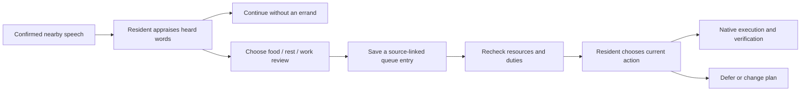

# Conversations that can lead to actions

NPCs can now choose a food, rest or livelihood review after hearing an exchange. Jev sees only their own needs, inventory, commitments, memories and the lines they heard. It can choose a follow-up, a subjective relationship response, or no new errand.

A follow-up records the source encounter, actor, focus, delivery IDs and heard claims. An existing pending need review receives that source instead of creating a duplicate errand. The next decision retains the source and rechecks current options. Speech never creates money, inventory, completed work or recovery. Choosing a review is not a promise, and finishing a review can legitimately end in deferral.

The observer shows the conversation source beside the current plan. Metrics distinguish chosen follow-ups, pending reviews, completed/held plans and actual outcomes. These are implementation traces, not a causal experiment proving why a model chose an action.

## Restrictions removed

Guards and residents with recorded duties are no longer categorically excluded from conversation, market visits, job opportunities or seated breaks. Their own commitments remain decision context. Social partners, sellers and advertised employers are no longer truncated to the nearest six. A seated break no longer requires crossing a hard fatigue threshold before it can appear in a resident's available choices.

Current native occupancy still matters. Actors already owned by another simulation activity cannot be assigned twice. Combat, sleep transitions and running Skyrim scenes currently defer new routing because those engine activities own the actor. There is no permanent quest-character blacklist in this path. Disabling every Skyrim quest or forcibly stopping native scenes has not been implemented; simply deleting these occupancy checks would produce competing packages and failed movement. A dedicated society-priority scene takeover remains required if the lab should replace those behaviors.

Model calls and native workers retain execution budgets. This implementation has three follow-up domains, one food commodity and one production recipe; it is not unrestricted planning or a complete organic economy. Spontaneous dialogue still needs stronger factual grounding and lower latency. Generating a departure excuse does not create a real work obligation.

## Verification

Controlled tests exercise heard dialogue → chosen review → native consumption acknowledgement → one loaf removed, along with no duplicate consumption. They also cover no follow-up from unheard words, merging an existing review, removal of future intentions on an older save, and more than six nearby guard candidates with duties. These tests use authored choices; live model selection of the new follow-up actions must be measured separately.
