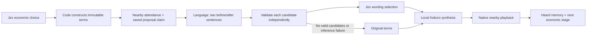

# Economic decisions become spoken encounters

Economic acts now use the same language/decision/voice separation as social dialogue. Jev chooses whether to seek work, bid, accept, refuse or counteroffer. Code constructs the exact economic sentence. Mercury proposes two short contextual wrappers, Jev selects one, and local Kokoro speaks the combined line. A completed nearby playback receipt is required before the encounter advances and records heard speech.

Generated design illustration, not gameplay. [Prompt](economic-wording-image-prompt.md). The map, portraits and septim UI remain documented in [Aerial observer](aerial-observer.md).

## Native evidence, including failures

Three operator-selected queued reviews used real model choices. None was forced to buy or accept employment. The same native checkpoint was restored between trials.

| Trial | Outcome | Generated / original fallback lines | Sampled elapsed | Reported model cost |
|---|---|---:|---:|---:|
| Initial, superseded | Seller declined | 2 / 2 | 115.300 s | $0.001390308 |
| Intermediate, superseded | Seller declined | 1 / 3 | 103.572 s | $0.001353428 |
| Final | Employer declined | 2 / 0 | 73.530 s | $0.000626410 |

These are provider-reported US-dollar costs across economic decisions and wording calls, not audited invoices. The final trial used Mercury 2.5 for two proposals and Jev for two wording selections and two economic decisions. Its heard lines were:

> Olfina: I hope you're doing well. Are you hiring for that 10-minute bread-making shift? Thank you for listening.

> Carlotta: I hear your question clearly. I am not offering you a shift right now. Thank you for understanding.

Both lines completed through native overlay playback with nearby attendance. **This is still formal, formulaic language, not proven human-like dialogue.** The 20.519-second gap from the first playback ending to the next prepared utterance is too long. Earlier gaps ranged from 7.529 to 26.401 seconds. These include pipeline work, not just provider inference, and are not eye-contact or response-perception scores.

This historical screenshot deliberately retains an awkward first-trial refusal: “With these uncertain times…” The final prompt discourages invented general conditions; lexical checks cannot guarantee every surrounding claim is grounded.

[All ten used audio clips](https://45ck.github.io/whiterun-society/#voice-example) are published with trial provenance and SHA-256 hashes. They are synthesized files used by the game, not recordings of physical output. [Sanitized decisions, timings, playback, balances and rollback receipts](economic-wording-evidence.json).

All three trials ended without a sale or accepted shift. Inventories stayed unchanged. Each restore matched all **17 compared fields**. No physical listening check, lip sync, eye gaze or raycast was qualified. Body-yaw measurements are explicitly labelled as body orientation.

## State and control flow

The generator returns separate `before` and `after` fields; code inserts `canonical_line`. It never asks the model to reproduce a price or task duration. The validator checks structure, sentence endings, added-word limits, repeated greetings, unsupported weather and a bounded set of economic qualifiers. A rejected candidate becomes a server-authored direct-terms option; a valid alternative remains available. Both rejected, invalid selection, or provider failure falls back once without an inference retry.

| Saved data | Purpose |
|---|---|
| `plan.natural_trade` | Enables contextual economic phrasing |
| `economic_speech.canonical_line` | Exact deterministic act and terms |
| `economic_speech.claim` | One persisted claim tied to the current native session and stage |
| `candidates`, `selected`, `direct_wording_ids` | Alternatives, selected wording and explicit original-terms replacements |
| `wording_results`, `wording_fallback` | Finite provider usage/timing and validation provenance |
| `economic_turns[].playback` | Completed speech, proximity and body-orientation evidence |

Listener private needs, inventory and memories are excluded from wording context. Own needs/profile, relationship knowledge, heard speech and observed clock are included. Wording cannot execute commands, change inventory or authorize a new economic act. Exact clause preservation does **not** independently validate every generated implication.

The resident worker accepts `--language-config` alongside `--voice-trade`. The daily director forwards its configured language model automatically for economic events. There is a maximum of ten wording calls per event and six economic decision calls; each economic language request has a 30-second timeout. Native movement, attendance, inventory and save handling remain deterministic. Actors do not require constant model inference while walking or waiting.

## Metrics and acceptance gaps

The observer now reports contextual delivered lines, original-terms fallbacks, rejected candidates, recorded call counts, model latency, known reported cost and reply dispatch gaps. Retained fixtures and superseded trials can contribute to save-derived metrics; these are operational measurements, not psychological validity scores. Human realism remains unscored.

Next acceptance work: shorter response gaps; concise, personality-sensitive language without repetitive courtesy; refusals and departures that feel natural; meaningful working/rest locations; repeated unforced economic chains; reliable physical RTS selection/pan/zoom; and recorded sound/video over a sustained run. No continuous livestream was started.

## Verification

The full Python suite passed **363 tests** before final candidate/schema refinements. After those refinements, **10 economic-language, 5 language and 10 metrics tests** passed. All **174 JavaScript tests** passed. Coverage includes partial candidate rejection, original-terms selection accounting, stale sessions, duplicate claims, private listener-state exclusion, incomplete playback and immutable terms. The final full Python suite was not rerun; hosted CI is not part of this evidence.
