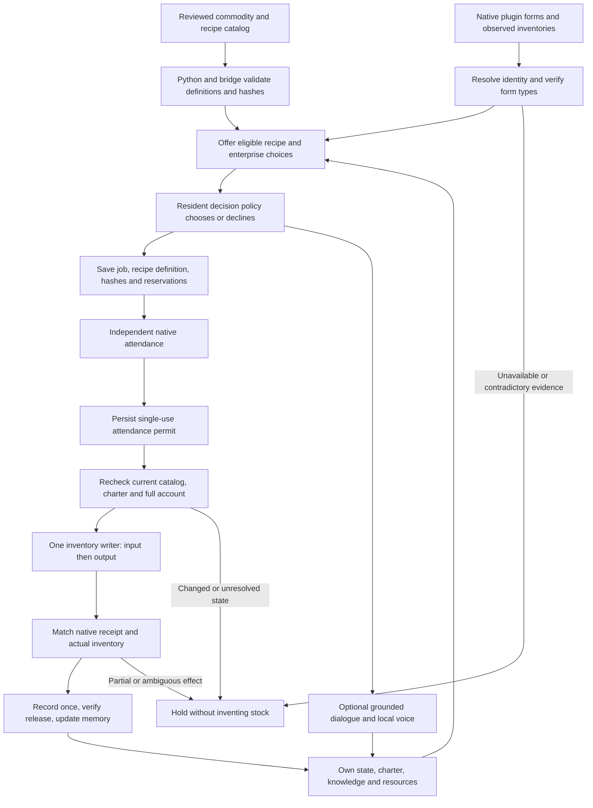

# Economy catalog: definitions, choices and verified effects

The catalog slice is implemented in source and has focused automated coverage. **It is not deployed or native-qualified by this documentation.** The checked-in manifest still enables only gold, bread, wheat-labelled grain and the existing authored bread recipe. A configurable transformation engine is not a complete economy, new industrial supply chain or autonomous production result.

*Generated architecture illustration. Depicted work activity is conceptual, not evidence of crafting animation or native generic production. Iron remains disabled. [Complete generation prompt](images/economy-catalog-flow.prompt.md).*

The authority is [config/economy-catalog.json](../config/economy-catalog.json). Python `economy_catalog.py` and `bridge/economy-catalog.js` validate equivalent definitions; `tools/deploy_bridge.py` validates and embeds the manifest when packaging a bridge. The service loads its catalog at process import. Editing JSON does not hot-update both running authorities: a changed manifest requires coordinated service/bridge preparation and new qualification, with old work settled or explicitly reconciled first.

## Data and decision loop

Models choose offered action/recipe IDs. They do not provide native form IDs, new executable recipes, quantities, inventory deltas or permission to mint resources. Language can describe an intention or verified outcome; speaking does not settle a transaction. Skyrim performs physical actions and inventory calls; deterministic code owns validation, conservation checks, receipts and save state.

The experimental perception loop now enumerates currently observed `isPerson` residents within the existing 40-entry census bound instead of three fixed actor references. This removes an identity-specific sampling restriction; it does not qualify vision. Perception remains `available: false` with an empty visible set, and grants no knowledge from unverified visibility.

## Current schema and enabled content

Schema version 1 permits 1–64 commodities and 1–128 recipes. Each commodity defines a logical ID, label, plugin/local-form reference, expected MISC/ALCH/INGR record class, currency flag and provenance. Duplicate logical IDs and duplicate native mappings are rejected. `gold` is the only currency; recipe transforms cannot consume or produce it.

A recipe has an ID and version, exactly **one positive input commodity and one distinct output commodity**, integer quantities from **1 to 1,000**, bounded labour duration and provenance. Work durations are bounded to **5–120 game minutes**. Inventory values must be complete, nonnegative integers within the native signed-count bound. Empty/free-output recipes, unknown commodities, fractional quantities, currency transforms and overflow fail validation. Cross-recipe cycles are not an economic-calibration test and are not automatically prohibited.

The enabled `bread_recipe` remains **one grain into two bread**, with a default 30-game-minute labour policy. It is an authored simulation conversion, **not** a claimed Skyrim crafting record. Gold, bread and wheat mappings were verified offline against the owned master; live installed form binding still requires its own checks. [Metadata and provenance](evidence/native-economy-items.json).

The generic test fixture transforms **two grain into three bread** to exercise data-defined quantities. It is test-only and is not added to the default manifest. The engine's generic capacity does not imply that arbitrary recipes, materials or stations are playable.

## Identity, state and accounting

Canonical sorted-key UTF-8 JSON produces `catalog_hash`. Each `recipe_hash` includes that full catalog hash and the recipe definition. A change to any manifest entry therefore changes recipe identities too. New owner and paid-production terms pin both hashes; new inventory intents pin catalog identity. Commands are not retrospectively stamped with a current hash merely because the service can read them.

Native resolution uses plugin/local-form lookup, checks the resolved reference identity, rejects commodity aliases, and feature-checks class casts and/or `getType`. Missing methods, unresolved forms or contradictory type evidence make the catalog unavailable. Unknown counts remain `null`/unavailable rather than zero. The service requires matching catalog and recipe hashes, the complete configured item list and type-verified native status before admission.

The observer shows whether game items are verified, missing, unavailable, mismatched or stale, with a plain-language blocking reason. Configured item/recipe counts are separate from verified native items and from stock or production. Stale evidence never receives the ready label; diagnostic hashes are available in the details panel.

An owner job pins its source plan, recipe definition, charter revision, labour policy, actor/base identity, catalog/recipe hashes and attendance identity. Account and business reservations prevent competing effects. Attendance produces a single-use permit; the one mutation lane derives and independently checks before, input-only intermediate and final account states. Only the exact native commit witness plus observed final inventory creates a production record. Other configured balances, including gold, remain unchanged. An inventory that merely resembles the intended final state is not a commit receipt.

Recipe policies are keyed by registered recipe ID. Generic policies use `target_output`; existing bread fields such as `target_bread` remain explicit compatibility fields. Resident founding choices require known recipes; catalog registration teaches nobody and creates no assets. Verified recipe learning stores its exact ID/version/input/output definition. Historical bread knowledge remains readable only through its explicit bread compatibility rule, not as knowledge of every new recipe. Operator-configured charters remain authored scenario state and must be labelled separately from resident-learned founding choices.

## Migration and scope limits

Historical receipts and legacy bread memories remain readable. An unsettled inventory intent without the required catalog proof is held and not dispatched; an old or changed owner job is held rather than re-certified. Prepared, partial or unknown effects keep their existing no-replay and quarantine requirements. This is conservative compatibility, not an automatic migration of every live save. Adding a commodity requires complete new observations; an old three-field account must not silently gain zero stock for an unobserved item.

The later [procurement slice](generic-procurement.md) implements reviewed market goods, explicit seller listings, known-recipe input demand, variable quantities and witnessed two-account transfers in source. Default enabled trade goods remain bread/grain; the fourth-commodity case is a test fixture, not active content or native qualification. Consumption remains bread and paid-work menus remain bread-oriented. Finite grants now have their own [reviewed scenario and delivery protocol](founding-resources.md). A catalog row alone still makes no item tradable, edible, known, produced or available. Multi-input recipes, equipment/station access, distinct business wallets, profitability, upstream replenishment and new industrial chains remain separate work.

Iron-smelting metadata is verified but **not enabled**: native `RecipeIngotIron` converts one ore to one ingot and requires `CraftingSmelter`. Stationary owner attendance does not prove workstation access or smelting animation. Station gating, an authored labour policy and appropriate recipe knowledge must be added and verified before activation; `metalwork_planned` remains nonexecutable. See the [remaining economy gaps](data-driven-economy-gap.md).

## Evidence and next qualification

[Hosted validation of revision 9e960a8](https://github.com/45ck/whiterun-society/actions/runs/40191242507) passed on Windows and Linux: 753 Python tests with one initial build-dependent skip, 293 JavaScript tests and six generated-plugin readback checks per platform. The first full catalog run exposed five scenario-fixture omissions; corrected runs retain the strict receipt contract. This final run includes the status display and qualification-harness corrections. No native catalog execution or industrial acceptance is claimed here.

The owner-work harness requires two existing eligible owners with pending need reviews and an existing pending social review with disjoint, currently eligible speakers. It uses that review's exact identity and rechecks it before starting. It creates no invitation, review, charter or stock to make its prerequisites pass.

A [read-only lab preflight](evidence/catalog-owner-work-preflight.json) at checkpoint 3183 confirmed that the installed bridge does not yet report the new catalog or owner-work capacity. The saved charters remain one bread business and one planned metalworking business. No owners or social opportunity can be qualified for this trial under the new contract yet; that is not a claim that the town has no owners. The check executed no trial, created no resources and made no cloud-model calls.

The next native case must first show matching installed catalog/form evidence, then two eligible owners independently attending while a separate conversation progresses, followed by serialized exact recipe receipts. Preserve every refusal and failure. Repeat catalog mismatch, stale account, changed charter, permit expiry, interrupted input/output, old-save and cold-controller cases. Compare queue waits and opportunities before claiming improved fairness. The [owner-work acceptance plan](independent-owner-work.md) describes that execution boundary; a successful rest/voice trial does not qualify owner production.
