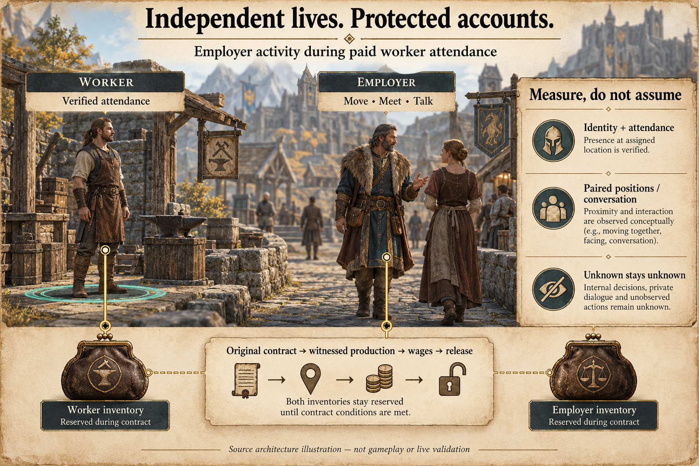

# Employer movement during paid work

Generated system illustration, not gameplay. [Full prompt](images/employer-concurrency.prompt.md). Paired samples below do not establish continuous motion or audible speech.

Paid work binds a worker's attendance and two inventory accounts. Those are different resources. The employer should be able to walk or converse while the worker attends, without being allowed to spend the reserved wage, sell reserved ingredients or change the contracted business.

**The account/physical lease split is implemented in source; it is not installed or qualified in Skyrim.** This document records the contract and qualification limits. The earlier [paid-employment validation](evidence/paid-employment-validation.json) belongs to its recorded revision and does not qualify this new concurrency behavior.

## What the lease permits

| Resource or action | Worker | Employer |
| --- | --- | --- |
| Physical attendance | Exact worker slot, package, serial, anchor and cell remain owned by the job | No hired-worker attendance obligation is inferred |
| Ordinary movement or non-economic conversation | Cannot displace the owned attendance task | May be admitted while current identity and activity checks remain valid |
| Inventory use | Reserved through settlement, release and terminal acknowledgement | Equally reserved; movement is not permission to spend or transfer |
| Contracted enterprise | Frozen recipe, policy and revision still apply | No competing production or charter mutation may invalidate the contract |

The service already checks the stationary worker independently from the employer. Employer movement, including a cell change, is compatible with the contract only while the employer remains loaded, correctly identified and available for exact account observation. Missing or changed actor/base evidence is not permission to assume the employer still exists elsewhere: the job holds according to its identity and effect state. The worker must retain its own exact physical lease and qualified attendance samples.

Both accounts and the business stay reserved until the recorded effects are reconciled, native release is verified and the terminal receipt is acknowledged. A non-economic conversation does not debit an inventory; food consumption, purchases, sales, further production, resource imports or another job must still pass the economic reservation checks. Uncertain/held or legacy records cannot gain freedom from a guessed role or missing field. No code path may reinterpret the employer's movement permission as ownership of the worker's slot.

The Python source keeps `paid_work_reservations(state, observation)` for both account IDs and business IDs, and adds `paid_work_activity_actors` for physical exclusion. Narrowing to the worker requires a current, unambiguous saved job plus matching native session, epoch and actor/base evidence. Missing observations, unbound/legacy identities, native-only orphan records, conflicting identities, cancellation, reset or held state retain both participants. Malformed records with unknown participants conservatively cover the managed/observed population and known identity hints. The global physical-reservation set unions this result with other activities; it never subtracts an employer from somebody else's valid lease.

The native controller likewise separates `accountActors()` from `activityActors()`, while `reservedActors()` retains the account-level compatibility meaning. Worker-only physical exclusion requires the exact current assignment and both valid native identities; this includes a saved `prepared` job before its native start acknowledgement, provided its current session/epoch and full assignment remain qualified. Any uncertainty restores the pair hold. Even a physically released worker remains excluded until the exact terminal acknowledgement, verified release and lack of unresolved effects permit its reservation to end.

Paid start now checks worker physical occupancy separately from both financial accounts. An employer's non-economic physical occupancy alone does not reject an otherwise valid start. An owner-work account lease, resource/trade reservation or other financial conflict still blocks it. A command's apparent success in an old cache does not override current lease checks.

## Concurrent activity is not concurrent settlement

Native attendance can continue while unrelated residents act and while an eligible employer follows a destination or talks. That does not remove the existing foreground command, conversation and checkpoint restrictions. Paid commit preparation still waits while foreground agency, conversation, movement-command or speech work owns the required lane. Inventory effects remain serialized and must use the original attendance token, full accounts and frozen consent.

A valid unrelated social acknowledgement, or inventories that happen to equal the final contract, cannot settle paid work. Finishing a newer employer activity must not overwrite the earlier worker's source plan. Original paid-job lineage determines which plan, contract, memories and learning are completed.

This is not an unlimited multi-conversation system. Global foreground scheduling and the single inventory writer can still delay settlement. Bounded attendance permits can expire while other work proceeds; retain the resulting hold rather than extending time or replaying effects implicitly.

The financial lease still covers each complete native inventory account, not only the ingredient and wage quantities. It is not escrow, a second business purse or permission for multiple jobs to share the same employer account concurrently. Finer-grained inventory reservations and simultaneous hiring against one purse would require their own conflict and settlement design.

## Measuring actual overlap

Permission to move or talk is a capability claim. Measured concurrency requires paired observations of a still-qualified worker and an independently active employer over the same interval. A single frame showing both residents, a queued social plan or an employer's destination label is insufficient.

The acceptance record should distinguish:

- Eligible paired observation intervals from intervals missing either participant, identity, timing, space or job evidence.
- Verified worker attendance overlapping measured employer movement, separately from overlap with a verified social interaction.
- Cumulative overlap from the longest continuous overlap; gaps, pause, stale samples and identity changes cannot silently join segments.
- Exact paid input, output and wage receipts from the movement/social telemetry; one does not certify the other.
- Physical activity exclusions from account/business exclusions, including rejected spending attempts while movement is allowed.

The source now implements `EmploymentConcurrencyTelemetry` and an `employment-concurrency-v1` projection. Snapshot fields distinguish inventory reservations, physical exclusions, currently observed worker attendance, employer activity and non-economic admission eligibility. Eligibility is not a promise of a reachable target, a selected action or an available foreground scheduler slot. An employer already attending a conversation is not simultaneously free for a new encounter.

The sampler keeps a 900-second rolling window, up to 256 samples, normally at five-second intervals. It rejects observation gaps above 30 seconds, uses an eight-unit displacement tolerance, excludes apparent speeds above 2,000 units/second and rejects game-time gaps above ten minutes. These are authored telemetry bounds, not validated biological limits. The projection exposes the policy and its hash. A new session/epoch, checkpoint rollback or discontinuous clock starts a new segment; observations do not reconstruct historical overlap after restart.

Paired intervals require the exact same job identity, worker lease serial/package and advancing native attendance samples/counter in the working phase. Pause, missing peers, identity loss and discontinuities are excluded and counted. Movement needs valid same-space positions; a cell transition or teleport does not become a measured travel distance. Conversation overlap requires matching conversation identity and qualified participant/base pair at both endpoints. A worker waiting for settlement after completing attendance is distinct from a worker still accruing attendance.

Each channel exposes known-pair count `n`, positive intervals, unknown intervals, sampled overlap seconds/game minutes and measured interval seconds/game minutes. No qualified known pairs means null overlap, not zero. Totals are **job-interval totals**, so simultaneous jobs can contribute overlapping wall time; they are not unique elapsed time. The implemented metric does not establish a longest continuous motion or audible-speech duration. Continuous overlap would require stronger observation and a separately qualified measure.

Do not infer 100% concurrency or increased economic throughput from permission or a few positive pairs. Report a numerator and its eligible interval/job denominator, excluded samples, source mode and build/configuration identity. An offline controller fixture is not measured Skyrim behavior.

## Acceptance and remaining limits

| Objective | Quantitative check | Evidence boundary |
| --- | --- | --- |
| Protect agreed resources | Zero accepted conflicting economic admissions in the tested trade, import, consumption, production and hiring cases | Report rejected / attempted cases; this is not a guarantee about untested paths |
| Demonstrate independent activity | At least one positive movement interval and one positive conversation interval while exact worker attendance advances in the controlled scenario | Fixture target only; ordinary residents may choose quiet or stationary activity |
| Keep measurements auditable | Every interval has a full job identity, matching worker lease and advancing attendance; publish qualified / candidate intervals and exclusion reasons | Never replace missing observations with zero activity |
| Complete the economic cycle | Production, wage debit, wage credit, release and acknowledgement must all pass before the later earned-wage purchase | Separate effect witnesses; final balances alone are insufficient |
| Avoid false eligibility | Zero fresh eligibility claims in tested error, stale, paused and identity-mismatch states | Native runtime remains unmeasured until a controlled game trial |

There is no validated human-realism score or target to keep everyone moving constantly. These measures qualify resource ownership and sampled concurrency; they do not establish economic complexity or psychological realism by themselves.

The offline interoperability suite uses the actual service, movement router, conversation-attendance controller and paid-work controller with simulated game APIs. The employer travels to a third resident and completes a two-turn non-economic conversation while the worker accrues attendance, then production and both wage legs settle. Separate cases cover admission while the employer already has physical occupancy, worker unload and employer base replacement. A retained paid-work integration checks that terminal acknowledgement clears the worker for an earned-wage purchase.

The positive fixture feeds actual controller observations into the telemetry sampler. It records five qualified attendance intervals, one displacement-bearing interval and two conversation intervals. Explicit fixture clocks yield five sampled movement job-seconds and ten conversation job-seconds; these are protocol expectations, not measured game duration. A permission-only snapshot and repeated observations cannot inflate overlap. Missing identity and stopped attendance are excluded.

Focused regressions cover employer inventory changes, worker anchor violations, competing activity reservations, stale consumption choices, direct trade/resource admission, stopped timelines and stale observer projections. Exact terminal acknowledgement suppresses only the matching old native projection; changed or conflicting identities retain protection. The UI distinguishes inventory reservation, activity admission, observed activity, eligibility and measured overlap.

[Hosted run 40210392239](https://github.com/45ck/whiterun-society/actions/runs/40210392239) passed for `a65d957` on Windows and Ubuntu: 1,280 Python tests per platform (1,279 passed and one initial generated-file skip), 504 JavaScript tests and six generated-plugin readback checks. The skipped check passed after generation; Windows compiled both Papyrus scripts. The four new concurrency interoperability cases and six existing paid-work interoperability cases all passed. [Machine-readable evidence](evidence/employment-concurrency-validation.json). These are source and simulated-native results, not audible speech, live model choice or Skyrim gameplay.

A controlled native case must keep the worker's exact attendance valid while the employer changes position and separately completes a non-economic interaction. Record both paired trajectories, the observed social receipt, stable reservations, exact recipe/wage effects and release/acknowledgement. Attempt a conflicting spend and preserve its rejection. Exercise employer unload/base replacement, worker interruption, partial effects, lost acknowledgements, cold controller loss and old-save restoration. Keep failed and held runs.

Then test unforced resident choices under the same rules. An employer may choose to wait instead of move or talk; that is a valid choice, not a reason to manufacture overlap. Productive animations, workstations, broader background conversations and sustained autonomous employment remain separate work. The full movie-first RTS economy and social simulation is not complete because one type of lease has been split.

Related: [paid-employment v2](paid-employment-v2.md), [independent activities](concurrent-activities.md), [population identity](population.md).
