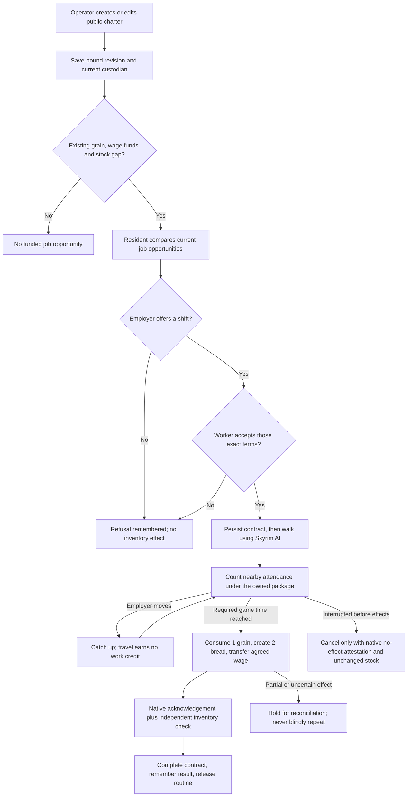

# Dynamic enterprises and employment policy

An initialized resident can now be registered as the custodian of a food shop or bakery through the visual control room. The census no longer assigns occupations to specific named NPCs. Existing saves retain their existing charters until explicitly edited.

An enterprise uses its custodian's actual Skyrim inventory. It has no second spendable wallet. Registration, renaming, changing a policy, closing, or changing the custodian does not mint resources or transfer belongings. Several charters may share the same physical account; their displayed inventories must not be added together as company wealth.

## The loop



The routine performs no model calls while walking or working. Jev chooses among the finite valid options at decision points. Language and voice belong to the conversation layer; an employment decision is not automatically a spoken exchange.

## What you can control

Open the running service's `/observer` page and use **Town enterprises → Create enterprise**, or **Edit** on an existing executable enterprise. Choose a currently loaded civilian resident, a public business name, food sales or bread production, and the following policy:

| Policy | Allowed range | Consequence |
| --- | --- | --- |
| Wage per completed shift | 1–20 gold | Must be funded from the custodian's purse; the employer and worker can refuse |
| Shift duration | 5–120 game minutes | Only qualified attendance counts; paused time and catching up do not |
| Replenishment target | 2–40 loaves | Stops generating funded work opportunities once observed stock reaches the target |
| Open or closed | Explicit flag | Closed enterprises stop advertising seller and employment opportunities |
| Custodian | Current initialized civilian adult | Changes which existing native inventory backs the charter; goods stay with their holders |

The verified recipe remains one grain into two bread. These adjustable values are authored gameplay policy, not an economic calibration or a claim of thousands of distinct human behaviours. Up to six current jobs can appear in one resident's need review; their differing terms can lead to different choices. Private employer balances and globally known personal names are excluded from the worker's decision context.

The browser sends a same-origin, token-checked request. Every change records a unique event, expected prior revision, resulting revision and checkpoint. An old form cannot overwrite newer terms. Active activities and unsettled contracts prevent charter changes. Duplicate identical requests do not repeat a change.

The CLI supports the same explicit specification for reproducible experiments:

```powershell
python tools/configure_enterprise.py --runtime D:\WhiterunLab\runtime --id unique-charter-event --spec enterprise.json --apply
```

Omit `--apply` for the current tool's read-only preview of the exact specification, custodian cohort and definition hash. Applying rechecks the current session/checkpoint and confirms the saved charter event. The command example does not qualify the new startup tool in-game or turn an operator-authored charter into a resident decision.

An example specification, using a **fictional test actor ID** that must be replaced with a currently observed resident:

```json
{
  "id": "district-bakery",
  "expected_revision": 0,
  "name": "District Bakery",
  "custodian": 7,
  "capabilities": ["bread_recipe", "retail_food"],
  "active": true,
  "production_policy": {"wage_gold": 4, "work_minutes": 10, "target_bread": 12}
}
```

## Live experiment and limitations

The visual editor applied **Plains District Bakery**, four gold per ten game minutes, target twelve loaves, to an existing live charter. The game observed revision one at checkpoint 649. No inventory was altered by the edit.

The first actual Jev trial deferred hiring, with returned action scores of 0.67 for deferral and 0.33 for offering a shift. The provider reported US$0.000091014. This is a valid refusal, not a successful employment contract.

A separately labelled deterministic integration fixture then exposed a native attendance failure after 0.7 game minutes. The original receipt is retained. Inventories stayed unchanged. The executor now allows a bounded catch-up interval, excludes that interval from attendance, and distinguishes attested no-effect cancellation from uncertain physical effects. The isolated pre-test save restored all fourteen original comparisons before the corrected test.

The corrected native fixture completed in 72.578 seconds including decisions, approach, ten qualified game minutes, inventory effects and release. Employer grain changed **21 → 20**, bread **4 → 6**, gold **106 → 102**; worker gold changed **28 → 32**. Combined participant gold remained 134. The native acknowledgement recorded ten attendance minutes, the owned package and a distance of 103 game units. Save `WS-Enterprise-20261025-AO`, checkpoint 674, restored **all sixteen compared state fields**. This proves execution of the custom contract; its acceptance came from explicit deterministic test decisions, not an additional successful Jev hiring choice. The successful native fixture used the existing Ysolda–Carlotta route; broader dynamic-owner shifts still need live qualification.

[Compact live receipts, retained failure and save comparison](evidence/enterprise-live.json). The full regression run passed 195 Python tests and 93 JavaScript tests before the final small compatibility/interrupt-memory checks. No new screenshot is claimed: Computer Use was stopped before capture.

Grain procurement and resident-selected food prices have since been added: [connected chain and native evidence](grain-market.md). Upstream farming, rent, taxes, debt, company-owned chests, skill-based productivity, crafting animations and autonomous business formation remain unfinished. Household and enterprise cash still share a physical purse. The population's accumulated hunger and fatigue also expose the need for a better continuously exercised daily schedule.

See [development plan](development-plan.md), [earlier agent-selected paid-work evidence](paid-work.md), and [personal knowledge and voiced dialogue](dynamic-society.md).
