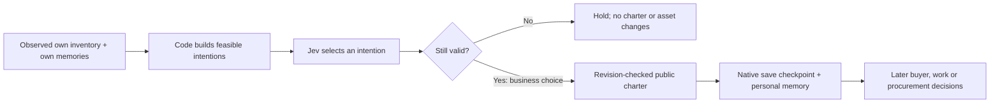

# Residents can register their own livelihoods

Residents can now choose to advertise carried food or grain, add a verified bread recipe, close an owned business, or reopen it. These choices share the same needs review as eating, employment, rest, travel and waiting. The operator no longer has to author every public enterprise. Registration changes the advertised services, not physical possessions.

Generated explanatory artwork, not gameplay. [Generation prompt](entrepreneurship-image-prompt.md). The numbered cards summarize a decision; procurement, production and selling are later choices, not guaranteed consequences.

## What was actually observed

Two queued reviews were run with real Jev decisions and the new options available:

| Resident | Available business choice | Actual choice | Verified effect |
|---|---|---|---|
| Carlotta | Advertise her 20 carried grain units, or close her existing charter | Eat bread | Four loaves became three; 102 septims and 20 grain stayed unchanged |
| Ysolda | Register a bakery using her own funds and earlier verified recipe participation | Ask Carlotta for paid work | Walked to Carlotta, asked aloud, heard a refusal; possessions unchanged |

The sampled worker intervals were **11.625 seconds** and **98.073 seconds**, respectively. Ysolda's interval includes a roughly 5,000-unit journey and two completed spoken turns. Three Jev calls together reported **US$0.000580482**. This is provider-reported usage, not a billing audit. Employment words were deterministic terms voiced by local Kokoro; no language model generated those lines.

Neither resident started a business in these trials. Do not interpret a new option as evidence of autonomous enterprise formation, profit-seeking behaviour, or psychological realism.

## Controlled registration and native persistence

A separate fixture selected an eligible queued resident from the currently loaded cast: **Nazeem**. It authored the allowed food-retail registration choice through the same persisted claim and decision endpoint. His **54 septims and one loaf remained unchanged**. A new public charter appeared, with Nazeem as owner and physical custodian. Other residents could discover that public service through the existing supplier query; no subsequent sale from it was qualified here.

The new business survived a native save/reload of `WS-Enterprise-20261025-BN`: all **17 compared fields** matched. Loading the pre-trial `WS-Enterprise-20261025-BM` also matched all **17 fields**, removing the future charter, consumption and memories. Trial effects were rolled back. Expansion, closure and reopening have automated checkpoint coverage; this trial did not qualify those three transitions in the native game.

[Sanitized decisions, balances, charter and persistence receipts](entrepreneurship-evidence.json) · [Hear the two employment utterances](https://45ck.github.io/whiterun-society/#voice-example). Clips are the synthesized files used by the game, not recordings of the physical audio output.

## Decision and data boundaries

The model selects an allowed action ID. It cannot supply a native command, invent inventory, nominate another owner, change a recipe, or overwrite an arbitrary business. Its selected specification is compared with the fresh option after inference; changed inventory or revisions reject it. Existing accepted or held employment contracts prevent charter changes.

| Record | Meaning |
|---|---|
| `person.known_recipes.bread` | Provenance of participation in verified production; preserved beyond the rolling memory window |
| `context.enterprise_options` | Current resident-owned specifications associated with permitted action IDs |
| `town.businesses[id]` | Public services, owner/custodian, revision, active flag and production policy |
| `town.enterprise_events` | Registration/revision history, originating plan and decision claim, with no inventory effect |
| `plan.enterprise_change` | Business ID, revision and event behind a completed choice |
| `person.memories` | The person's own business-change memory; other people's private plans are not disclosed |

Completing verified paid or owned bread production teaches the recipe under an **authored learning rule**. Older saves can recover the same knowledge from their own retained verified work memories. Hearing about a recipe does not establish knowledge. Failed or interrupted production does not teach it. This is a gameplay approximation, not a validated human skill model.

All initialized, currently observed adults can consider their own services, including guards when their current activity permits it. There are no named-NPC role assignments. A missing or replaced resident, occupied actor, absent stock, exhausted capacity or conflicting owner prevents the corresponding option.

## Breadth and remaining work

This adds **five enterprise intention families**: offer food, offer grain, register a bakery, close, and reopen. Current executable services remain **three capability types**. Eligibility varies with stock, knowledge, commitments and the changing cast. Counts of actor/action combinations are not evidence of human-like complexity.

Businesses share the owner's physical inventory with household resources; there is no separate firm wallet or building. The starter recipe, wages, target stock and duration are authored defaults. Prices and individual contracts are later decisions. Native walking and inventory effects remain deterministic/game-owned execution. Registration itself needs no voice; conversations retain their separate language, decision and audio pipeline.

The observer now displays resident business decisions separately from operator charter edits, including qualification experiments in the current save. The inspector identifies controlled fixtures. Remaining acceptance work includes unforced enterprise formation and profitable repeated trade, equipment and productive places, farming, durable firm accounts, natural business dialogue, reliable RTS input and sustained audio/video qualification.

## Verification

The full Python suite passed **354 tests**. After the final legacy-industry compatibility filter, all **8 entrepreneurship tests** passed again; all **173 JavaScript tests** passed. The full suite was not repeated after that isolated filter. Older planned-industry records cannot offer invalid executable revisions or prevent their owner from registering a separate supported service. Native registration/reload and rollback matched all 17 fields each. Hosted CI is not part of this evidence.
