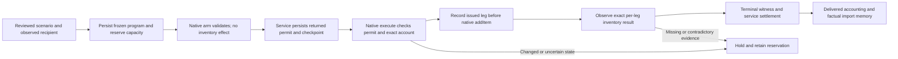

# Finite starting resources and resident meals

## Data-defined resource scenarios: implemented source

The source protocol replaces identity-specific engine allocations with a reviewed scenario definition: a uniform **20 gold, 2 bread and 2 grain** per eligible recipient, bounded by a finite external pool of **1,000 gold, 100 bread and 100 grain**. Optional exceptional allocations belong in explicit actor/base-bound scenario data, not branches on NPC names or IDs in the execution engine. This definition is authored starting capital, not earned revenue, economic calibration or an autonomous agent decision. Census remains resource-free.

The manifest, native controller, service checkpoints and explicit request/helper contracts below are implemented in source and were inspected together. **They are not installed or native-qualified.** The historical 29-recipient trial below used the earlier allocation policy and does not qualify the replacement.


*Generated conceptual illustration, not gameplay or evidence of native success. Availability is reduced at reservation; settlement moves reserved quantities to delivered without reducing availability again. The native witness is live-only. [Full generation and correction prompts](images/finite-resource-delivery-flow.full.prompt.md).*

### Frozen program and finite accounting

The reviewed definition lives in [config/resource-manifest.json](../config/resource-manifest.json), with Python/JavaScript validation in [resource_manifest.py](../resource_manifest.py) and [bridge/resource-manifest.js](../bridge/resource-manifest.js). Its current ID is `founding-resources-v2`, policy version `uniform-experimental-v1`. The checked-in override list is empty: no original cast member receives special treatment in this default.

| Definition field | Meaning |
| --- | --- |
| `schema_version`, `id`, `version` | Schema 1, stable program identity and authored policy revision |
| `catalog_hash` | Exact reviewed commodity catalog; the manifest cannot silently adopt another catalog |
| `capacity` | Finite source quantities for every configured commodity |
| `default_grant` | Complete per-commodity allocation for a recipient without an explicit override |
| `overrides` | At most 128 uniquely identified entries, each with `selector: {actor, actor_base_id}`, complete `grant` and `provenance` |
| `max_recipient_stock` | Bounded recipient-stock admission policy |
| `provenance` | Explicit authorship and origin, distinct from earned income or inferred wealth |

Quantities are nonnegative bounded integers with exactly the configured commodity keys. A grant must contain at least one positive quantity and cannot exceed the finite pool. Duplicate selector identities or actor references are rejected, including the same actor with a different base. If an actor matches an override but its base does not match, selection rejects rather than falling back to the default. The parser rejects duplicate JSON fields and limits the UTF-8 manifest to 256 KiB.

The manifest digest covers canonical sorted-key JSON, including its provenance. A separate grant digest binds the catalog, manifest, selected actor/base, selector and quantities. A manifest edit therefore changes authority even when the edited field would not alter the immediate amount. Commands do not replace the installed reviewed definition with caller-supplied policy.

An operator request must identify the reviewed scenario and its exact digest. The first accepted grant freezes the definition and catalog identity into one saved resource program for that timeline. Subsequent requests cannot change that program's allocation or create a fresh pool by choosing another scenario ID. The recipient's observed actor/base identity, classification, account and reservations must still be valid; a definition never creates a missing resident or supplies unobserved balances.

Track each configured commodity separately:

`capacity = available + reserved + delivered`

A prepared grant moves capacity into a reservation before effects are authorized. Only qualified delivery can settle that grant into delivered capacity. A held or uncertain grant must not be made available for another recipient merely because a worker, timer or controller stopped. The compatibility `remaining` total is `capacity - delivered`, so it includes reserved amounts and must not be displayed as spendable availability.

### Arm, persist, execute, observe



Native commands use `kind: inventory_endowment`, `protocol: 2` and `phase: arm` or `deliver`. Arming alone adds no inventory. Delivery requires the persisted permit and current identity/contract checks. Within a live native controller, each positive commodity leg is processed in sorted key order and marked issued before calling the native inventory function; observed whole-account transitions supply the witness before the next leg. A matching final balance without those issued/observed witnesses is insufficient because another source could have supplied the same goods.

The arm permit expires after 120 seconds before delivery; an issued leg has a five-second observation window. Clock reversal, drift, timeout or a native call error holds the operation. The live controller retains up to 128 grant records without automatic eviction, prevents a second grant to the same reference in an epoch and checks cumulative live reservations against the manifest's capacity. This secondary live bound does not replace the service's durable source pool. Repeating arm after an issued effect reports that evidence and cannot certify a new effect-free permit.

The service checkpoints reservations, permits and terminal receipts durably. **The native issued/effect journal is not crash-durable.** Controller reset, a new game session or an invalid epoch holds unresolved execution without replay. Do not describe this as exactly-once delivery across crashes. Partial physical effects may exist while the full grant remains reserved and uncredited; reconciliation needs evidence rather than automatic retry, rollback or release of capacity.

### Explicit requests and helper behavior

`POST /town/endow` accepts exactly `actor`, `scenario_id` and `scenario_hash`. The actor is explicit; the scenario hash must be the reviewed manifest digest. Callers cannot provide arbitrary grant amounts, overrides, a replacement manifest or a recipient profile through this endpoint. Service observation cross-checks loaded and accounting rows, actor/base identity, adult classification, catalog types, complete balances and the accounting checkpoint. Conflicting channels are rejected rather than selecting whichever balance is convenient.

An accounting row that temporarily trails the bound checkpoint causes a read-only wait for fresh evidence, with no permit persistence or delivery credit from the stale row. A changed session, executor epoch, recipient base or contradictory witness is a hold. Frozen pool counters are checked against the saved delivery journals as well as the conservation equation.

The helper requires an explicit local manifest path. From the repository, replace `OBSERVED_ACTOR_ID` with the intended initialized resident's current decimal reference ID:

```powershell
python tools/endow_population.py --root D:\WhiterunLab --actor OBSERVED_ACTOR_ID --scenario config/resource-manifest.json
python tools/endow_town.py --root D:\WhiterunLab --maximum 32 --scenario config/resource-manifest.json
```

These are documented interfaces for a future qualified installation, not commands executed by this documentation update. The helper verifies matching native capability before requesting delivery. The batch freezes its eligible recipient list, records unavailable recipients and stops on a held import or changed session. It does not discover new recipients midway or replenish the source. Read-only polling waits for the matching committed receipt; a timeout, connection failure or unknown write response is not resubmitted. A new invocation cannot replace a legacy or differently hashed saved program.

An identical recipient request returns the existing saved claim, whether pending, held or committed; it does not reopen the pool or create another delivery. Displaying a saved claim is different from confirming fresh delivery. Unknown outcomes remain held until separately reviewed.

### Historical program handling and qualification

Completed older imports remain readable historical evidence. Unfinished legacy contracts are held rather than upgraded to a new permit, and a timeline with an old resource program cannot receive another fresh program under a new scenario ID. This preserves old accounting without pretending its weaker delivery provenance meets the new witness contract.

The next native acceptance must begin with a fresh isolated save and explicit census, verify matching deployed scenario/catalog identities, then deliver a uniform grant to a newly discovered recipient. Record the no-effect arm, persisted permit checkpoint, exact inventory before/intermediate/after, terminal witness and `available/reserved/delivered` totals. Show one repeat request without any additional effect. Test an actor/base override as a separately labelled authored case, not a native identity exception.

Before broad rollout, retain at least 30 controlled replay/failure cases spanning exhausted capacity, competing reservations, changed scenario/catalog hashes, actor replacement, missing classification, drift between legs, lost acknowledgements, timeout, controller reset, new epoch/session, older-save restore and legacy incomplete grants. Require zero unverified pool debit, memory grant or reissued uncertain leg. These are proposed acceptance requirements, not current scores or a claim of crash-proof execution. All failures and partial effects stay in the evidence denominator; no runtime test was performed for this document.

Focused source verification reported 56 passing service/fault/interoperability tests: 10 service cases, 43 resource fault cases and three Python/Node controller interoperability cases using fake native actor/form APIs. Separate suites reported nine manifest/schema/cross-language parity tests and 58 native-controller JavaScript tests passing. These scopes overlap and are not added into a unique aggregate. They do not execute Skyrim, install a bridge, qualify audio or establish native crash recovery.

## Historical allocation and native trial

The recorded earlier trial funded 29 initialized adult residents in their actual Skyrim inventories. This was scenario initialization, not earned income. Its finite external pool funded each recorded grant in the saved lineage; household and business records did not create duplicate purses. The following allocation and native/save results remain unchanged historical evidence.

### Historical allocation

| Recipient | Gold | Bread | Grain |
| --- | ---: | ---: | ---: |
| Ordinary initialized adult, each | 20 | 2 | 0 |
| Carlotta, including food-enterprise capital | 100 | 2 | 20 |
| Total delivered to 29 residents | 660 | 58 | 20 |
| External pool remaining | 340 | 42 | 80 |

The authored pool began with 1,000 gold, 100 bread and 100 grain. It is not a resident wallet and does not replenish automatically. Family size, assets and wealth are not inferred from appearance. These are explicit prototype allocations, not a calibrated reconstruction of Whiterun's economy.

The service persists a prepared grant before authorizing native effects. Skyrim checks the bounded contract, adult classification and exact inventory at each delivery stage. Only a completed native observation debits the external pool and adds a receipt and factual memory. Drift, timeout and partial failure hold the operation rather than retrying blindly. Loading an older save selects its own grant history and remaining pool.

### Historical native results

Idolaf received 20 gold and two loaves; Saffir then received the same grant while her 3D was unloaded. The remaining 27 deliveries completed sequentially in 126.074 seconds. All 29 have committed receipts. Of those receipts, 22 explicitly report unloaded 3D, six report loaded 3D, and the first Idolaf receipt predates that flag. These are native inventory changes, not evidence that unloaded NPCs walked or acted physically. No model calls were required for distribution.

The bridge now reports a separate accounting inventory for initialized residents, including unloaded references. This does not add them to the visual/perceptual census. The service and visual overview distinguish native account observations from loaded actors.

The next bounded daily review made three actual Jev decisions: a Whiterun guard, Amren and Adrianne each chose to eat. Skyrim removed one carried loaf from each before simulated hunger fell from 1.0 to 0.4. Across the 29 observed accounts, bread fell from 62 to 59; gold stayed at 964 and grain at 21. These totals include pre-existing items as well as the grants. The three calls reported US$0.000140364 in aggregate cost. This trial did not demonstrate new sales, wages, dialogue or an eating animation.

### Historical save and restart evidence

| Save | Checkpoint | Result |
| --- | ---: | --- |
| WS-Resources-20261024-Q | 192 | Warm restore passed. After process restart, two unmodified guard purses differed; Idolaf's funded inventory remained exact. |
| WS-Resources-20261024-S | 248 | Cold launch and restore passed all compared fields, including native inventory for all 29 funded accounts. |
| WS-Resources-20261024-T | 267 | Post-meal warm restore passed all fields, including all 29 inventories and the three consumption records. |

Cold launch plus verified restore of S took 36.7 seconds. Explicit inventory modification may explain why these funded accounts persisted when earlier unmodified purses differed, but the engine-level cause is not established. The failed Q comparison remains in the evidence; this result does not establish indefinite persistence through respawns or every external engine change.

### Historical helper invocation

```powershell
python tools/endow_town.py --root D:\WhiterunLab --maximum 32
```

This command records the earlier helper interface, not a valid invocation of the new scenario-bound protocol. The earlier batch used initialized, natively observed accounts, skipped committed grants and stopped on delivery failure or session change. Its first accounting heartbeat could require a service round trip. The new explicit-scenario helpers are documented above; do not run this historical command as a migration step.

To reopen an existing verified local scenario without a playthrough:

```powershell
python tools/launch_demo.py --root D:\WhiterunLab --audio-diagnostic --save WS-Resources-20261024-T
```

That named save and its local proof must already exist. Saves and game assets are not distributed in this repository. The diagnostic flag retains disabled native audio; overlay voices use their separate channel. This is not a fix for the earlier native-audio crashes.

### Historical verification and remaining scope

That version's local verification passed 106 Python tests and 68 JavaScript tests. Its checks covered finite-pool exhaustion, duplicate grants, save lineage, partial delivery, hot reload, inventory drift, unloaded accounting and adult classification. Those are historical counts, not the new protocol's tests. The live results above are separate evidence from those tests.

The earlier overview showed inventories, grant receipts and remaining external resources; that presentation was not manually inspected in-game for the recorded trial. The initialized roster was not every Whiterun inhabitant. Later capability-based employment and production work has separate evidence and does not change these historical results. The active scope is movie-first RTS observation, with direct player interaction deferred. Sustained supply chains, housing/kinship and broader social mechanisms remain open; needs and personality parameters are authored simulation heuristics, not validated psychometrics.

Evidence: [resource grants](evidence/founding-resources.json), [three scheduled meals](evidence/founding-daily-life.json), [Q including the failed cold comparison](evidence/resources-save-Q.json), [S cold restore](evidence/resources-save-S.json), [T post-meal restore](evidence/resources-save-T.json). Related: [daily life](daily-life.md), [Papyrus routing](papyrus-routing.md), [paid work](paid-work.md).
