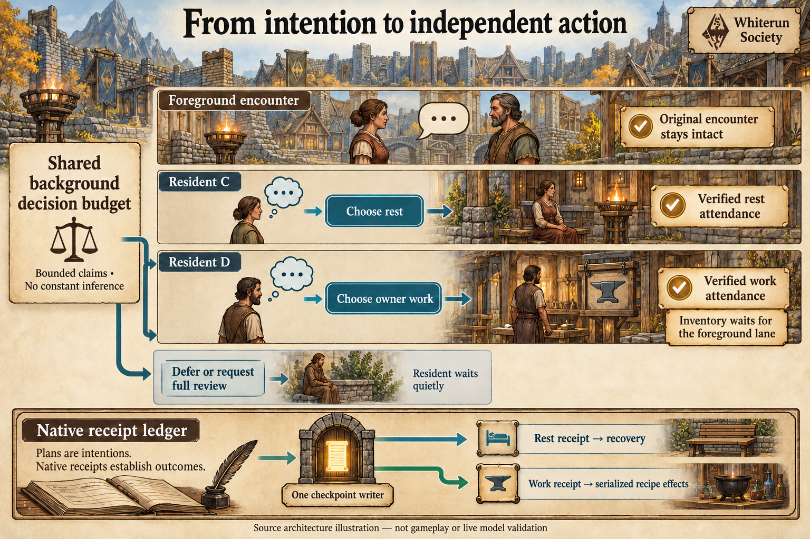

# Independent reviews and purposeful follow-through

Generated source architecture illustration, not gameplay. [Full prompts](images/independent-followthrough.prompt.md). Native outcomes require the separate evidence described below.

A resident finishing a journey should be able to reconsider its own needs and begin feasible self-care or owner work while an unrelated foreground encounter continues. That requires an independent decision claim and plan lineage, not merely another destination or a larger model-call allowance.

**This milestone is implemented in source; it is not installed or qualified in Skyrim. Hosted full-suite qualification passed at source revision 220e07d; native qualification remains pending.** The slice covers independent reviews and delegation to existing rest/owner-work executors. Shared run budgets, per-actor reservations, native receipt checks and the single inventory writer remain authoritative. Focused source evidence is separate from final integrated/hosted qualification. It does not complete all-resident autonomy, parallel bargaining or the full economic/social programme.

[Hosted run 40212669424](https://github.com/45ck/whiterun-society/actions/runs/40212669424) passed on Windows and Ubuntu: 1,359 Python tests per platform (1,358 passed and one initial generated-file skip), 512 JavaScript tests and six generated-plugin readback checks. The skipped check passed after generation; Windows compiled both Papyrus scripts. Four actual-controller integration cases passed with simulated native APIs. [Exact evidence and limitations](evidence/independent-followthrough-validation.json).

## Review claims and saved plan authority

`independent_review_candidates` considers pending `need_review` events with a rest/work `goal_followups` source. Residents must have qualified current actor/base identity and be free of relevant occupancy. It does not turn every pending food, social or paid-job decision into an independent action. Each resident appears once in a claimed wave.

The current action set contains `defer`, `foreground_review`, feasible rest destinations and feasible owned-recipe work. Rest uses the existing two-slot capability and its verified seated-break protocol. Owner work requires a configured recipe, explicit executable charter, stock, account and executor evidence. The current owner executor treats charter capability as authority; it does not separately re-prove personal recipe knowledge at this admission boundary. The context contains the resident's own profile, needs, observed inventory, recent memories, commitments, position and weather; this is not access to other residents' private state. If history removal cannot bring the required context under its configured limit, admission fails rather than silently deleting feasible options.

`claim_independent_reviews` persists a wave identity, claim ID, session, policy snapshot and deadline before inference. The daily source events become started and are bound to that wave. Claims acquire no physical or account leases. Personal-goal and independent-review APIs share one active thinking-wave exclusion; a duplicate/retired wave ID cannot create another inference wave. The result must cover exactly the claimed residents and be submitted to the same unexpired claim/session. Losing one member's identity holds that member; session change or the wave deadline invalidates the whole wave.

`finish_independent_reviews` validates the decision against both the saved and freshly derived feasible context, including exact selected action terms. Changed identity, occupancy, recipe/business terms, unavailable targets, failed inference or malformed results cannot become an accepted action. Deferral records no effect and schedules a later review; `foreground_review` returns the event to the ordinary queue with a marker preventing independent re-capture. Neither is a failed physical job or a completed meal/work event.

Accepted rest/owner choices create `independent_plans[event_id]`, separate from the foreground `plans` list. An `independent_review` provenance record binds event, wave and claim; `activity_plan_hash` pins the actor/base, session and selected rest target or owner-work terms. Delegation checks the exact saved plan object, accepted record and still-started source event. `find_activity_plan` searches the two stores by ID and rejects ambiguous identities. Completion or hold updates the matching source plan, preserving a newer or unrelated foreground plan.

The [review policy](../config/independent-reviews.json) currently bounds a wave to 32 residents, a claim to 1,800 seconds, an accepted intention awaiting delegation to 300 seconds, and context to 14,000 serialized bytes. Deferred/held reviews use a 15-game-minute reconsideration interval. Saved review capacity is 4,096 records, with 16 wave records retained; capacity is not an unlimited backlog. These are authored limits, not a guarantee that 32 provider calls run simultaneously or that every resident receives a useful action. The worker's actual inference concurrency and shared run budget remain separate bounds.

## Delegation, settlement and shared budgets

Independent owner admission accepts an authorized `ready_to_self_work` plan without replacing the foreground plan. It rechecks actor/base/session, occupancy, business/recipe/catalog identity, account balances and slot capacity. Rest admission uses the corresponding exact `ready_to_rest` authority and its existing actor/seat/slot conflict checks. An accepted intention has no recovery, output or money merely because it was stored.

Native rest and owner attendance can then progress alongside a disjoint foreground encounter. Inventory preparation still waits for the foreground and command/checkpoint lane to permit the single authoritative writer. A completed attendance interval does not extend its permit indefinitely: expiry or changed prerequisites hold the job without new credit or automatic extension. Rest recovery, owner input/output effects, release and receipt acknowledgement keep their existing evidence boundaries.

The review worker uses `/independent-reviews/claim` and `/independent-reviews/result`, retains results during checkpoint waits and does not re-infer a completed model response merely because submission is delayed. Session changes or claim expiry hold rather than replay. Its model calls must be charged to the same bounded session accounting as other background decisions; a new lane is not new spending authority. Final integration evidence must verify that full call accounting, failures and admission limits remain shared.

The scheduler source shares **one subprocess and one background-call budget** between personal-goal waves and independent-review waves. When both are eligible it alternates lanes; each worker can run at most four concurrent inferences. Before launch it reserves the wave's maximum calls from the remaining allowance. Only a valid settled receipt can return unused capacity. Failed or uncertain attempts retain their reservation and hold the lane; missing provider cost is not a free call. It reports goal, independent-review and combined background call counts separately. Foreground event budgets remain separately bounded by the full frozen run policy.

The source `independent-review-metrics-v1` projection separates waiting, claimed, accepted, delegated, native-attending, settled, held, foreground handoff and quiet outcomes. Waiting includes pending need-review events, not a claim that all are eligible. It traces source event, wave/claim, plan and native-job links with known/unknown coverage, and reports claim-to-result and result-to-native-admission timing distributions. Claim-to-result includes queue time; neither a saved claim nor a phase label proves a model is currently running. Quiet and handoff need no native job. Actual attendance needs fresh exact identity/job evidence; settlement needs the linked committed rest or production receipt. Retained-save counts are not lifetime throughput or human-realism scores.

## Acceptance and evidence boundaries

The core owner reported 18 independent-review tests, 18 existing resident-goal tests and ten goal-follow-through tests passing. Independent-rest admission reported 11 passing tests and independent-owner admission six. The metrics owner reported 21 new tests covering saved transition/coverage logic with explicit attendance and inventory fixtures. A local JavaScript run reported 512 passing tests. These are differently scoped, potentially overlapping source suites, not a summed unique total or hosted/native qualification. Generic personal work discovery now uses configured recipes/charters, personally feasible stock and public employer metadata; a synthetic metal recipe tests choice generality without enabling an industrial chain.

Four integration tests passed through real SQLite service checkpoints and actual JavaScript rest/activity, owner-attendance, production, Papyrus-routing and catalog controllers with **mocked actor/form/mailbox/physics APIs**. In the positive four-resident fixture, a foreground pair retained an accepted route and conversation at `propose`; no spoken or audible turn was claimed. Two other residents selected rest and owner work through actual personal-goal and independent-review claim/result paths using authored fixture decisions. Rest settled once while the foreground remained unchanged. Owner attendance progressed concurrently, but its exact one-grain debit/two-bread credit waited for explicit foreground release. Other cases retained competing-seat rejection, account-purchase exclusion during work and per-member identity failure. This proves an offline control/lineage path, not unforced model choice, continuous native overlap or gameplay.

Keep eligibility, decision admission, selected action, delegated native job, physical progress and settled consequence separate. A due queue entry is not an active inference, and a claimed decision is not completed work. Rest, refusal and quiet can be valid choices; no movement or production quota should force an outcome.

| Measure | Numerator / denominator or distribution | Required interpretation |
| --- | --- | --- |
| Independent review admission | Qualified due reviews admitted independently / eligible due reviews in the same window | Retain exclusions for actor identity, reservations, stale state, missing capability and budget. No denominator from the entire historical roster. |
| Follow-through lineage | Delegated jobs with an exact independent source plan and claim / all independently delegated jobs | An original source plan must not be replaced by a newer foreground plan. |
| Decision delay | Due-to-claim and claim-to-result distributions, with sample counts and unknowns | Queueing is not model reasoning; provider latency and scheduling delay stay separate. |
| Real overlap | Qualified independent physical-job intervals overlapping a verified disjoint foreground encounter / eligible paired intervals | Permission and simultaneous plan labels do not prove overlap. Sampling gaps and paused/unloaded time are excluded. |
| Valid consequences | Receipt-backed rest recovery or owner-production settlements / admitted jobs of each kind | Report each activity type independently; held, partial and release-unverified jobs remain visible. |
| Shared budget accounting | Inference calls attributed to the shared run allowance / all attempted inference calls | Include failures, retries and rejected responses. Starting a second worker must not create another allowance. |
| Reservation safety | Rejected conflicting admissions / exercised conflicting admissions | Also retain missed conflicts and unintended effects; a rejection count alone is not quality. |

The first controlled integration should keep one foreground encounter alive while two disjoint residents independently review and delegate one rest and one owner job. Verify the original encounter is unchanged, both jobs retain their own claims/plans, physical attendance progresses, and settlement waits safely for the single mutation lane. Then exercise actor/target contention, stale claims, roster replacement, provider failure, budget exhaustion, cancellation, simultaneous terminal receipts and save/session changes. An offline fixture must remain labelled as such; a later unforced native trial must preserve all refusals and failures.

## Next-work audit: catalog v2 and variable recipe legs

This is **future work**, not part of independent review delivery. The current catalog validator requires exactly one input and one output. Several downstream mechanisms also depend on that shape, so accepting larger dictionaries alone would create an incomplete and unsafe migration.

| Boundary | Current assumption | Required migration |
| --- | --- | --- |
| Catalog validation and identity | `economy_catalog.py` and the native catalog bind a one-input/one-output definition | Introduce a separately versioned bounded schema with exact positive quantities, registered commodity references, canonical order/hash and explicit rules for overlapping inputs/outputs, catalysts and byproducts. Preserve existing definitions and receipts. |
| Owner native effect journal | `bridge/production.js` retains individual input/output issued/observed flags and a single intermediate inventory | Replace the fixed two-stage journal with ordered per-leg identities, full-account expected stages, issued-before-call evidence and observed progress. Partial effects and controller loss must hold without replay. |
| Paid native and service settlement | `paid_employment.py` expects four legs; output/payment flags depend on fixed stage positions | Validate every configured input and every output before declaring production verified, then both wage sides. A first output is not proof of all outputs. Update controller, service, receipt hashes and metrics together. |
| Enterprise stock policy | `owner_production.py` and `procurement.py` use the first output to determine a stock target; `production_policy` has one scalar output target | Define target semantics per product or per recipe, including joint-output bottlenecks, storage limits and surplus. Derive feasible batch count from all inputs and capacities, not a dictionary's first entry. |
| Demand and reservations | Procurement can examine recipe inputs but currently derives batch demand from one output target | Calculate bounded remaining input demand from the selected production plan. Preserve alternative-choice versus committed-reservation semantics and avoid double-counting shared stock across enterprises. |
| Knowledge, speech and UI | Knowledge pins the exact recipe; dialogue and displays currently exercise the smaller schema | Revalidate complete recipe knowledge without silently teaching a changed recipe. Speak and display all contractual quantities accurately, with bounded context and no invented available stock. |

Acceptance must include at least one multi-input/one-output, one-input/multi-output and multi-input/multi-output fixture; unequal quantities; insufficient non-first input; capacity failure on a non-first output; reordered manifest keys; and interruption before/after every effect leg. Verify all configured account deltas, no change to unrelated goods, bilateral wages, no learning from incomplete work and no duplicate consequence after replay. These are proposed test classes, not passing results. Native workstation access, tools, upstream replenishment, prices, profit and human-realism claims remain independent concerns.

Existing pending schema-v1 effects cannot be reinterpreted under v2 after a restart. Define an explicit compatibility/hold policy, retain historical receipts under their original schema and require a reviewed migration before activating new recipes. A renamed test recipe or one generic batch is not this migration.

## Next-work audit: spoken bilateral commitments

This is also **future work**. `social_followthrough.py` currently lets a resident queue its own food/rest/work review after hearing a conversation. It explicitly records a heard claim and self-directed reconsideration, not a promise or agreement. Existing personal `commitments` fields and employment contracts do not provide a general spoken bilateral commitment lifecycle.

A future commitment needs an explicit offered obligation, identified parties, bounded action/object terms, due time or condition, proposal/acceptance evidence, visibility and cancellation rules. Both sides must hear and accept the same relevant terms before a shared obligation exists. A generated line such as “I will bring supplies tomorrow” must not silently create a mutual contract, mint goods or reserve somebody else's resources.

Use a versioned state model covering proposal, acceptance, rejection, withdrawal, renegotiation, fulfilment and breach or disputed outcome. Link fulfilment to actual action receipts; deadlines need qualified game time and a documented pause/unload policy. Missing evidence is unresolved, not automatically betrayal. Keep claims, direct observations and hearsay separate, and expose only information each resident legitimately knows.

Acceptance should measure valid accepted commitments / explicit paired proposals, receipt-backed fulfilments / due accepted commitments, unresolved outcomes / due accepted commitments, and duplicate or unauthorized obligations / exercised invalid/replay cases. Retain refusals, renegotiations and false accusations rather than optimize a drama quota. Relationship consequences require their own traceable policy and sensitivity experiments; a change in an affinity number is not validated psychology.

The initial controlled test should deliver a specific offer, a matching accepted response and a later verified consequence, alongside rejection, interrupted speech, mismatched terms, timeout, actor replacement and duplicate-receipt cases. An unforced model conversation is a separate qualification. This audit records substantive next work without claiming it is implemented by independent need reviews.

Related: [living-city roadmap](simulation-roadmap.md), [independent activities](concurrent-activities.md), [owner work](independent-owner-work.md), [paid employment](paid-employment-v2.md), [employer concurrency](employment-concurrency.md).
