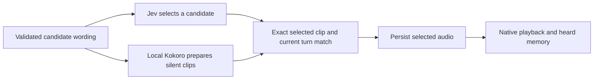

# Movie view and prepared NPC voices

Movie view is now the default camera mode, including camera reset. Manual RTS overview, resident selection and close inspection remain available. The camera prioritizes an active conversation or economic encounter, then an active independent journey. It holds the last composition between activities; it does not invent a scenic tour. At startup with no activity, it uses the establishing market view. Camera collision remains unverified.

A compact card rotates every **12 seconds** through the save's verified sales/production totals, resident and queued-decision counts, current encounter, and latest completed queued activity. It refreshes from incoming game observations and disappears during manual camera control. Unknown quantities show a dash. Queued decisions are explicitly distinct from active thinking. An independently running test encounter is labelled separately from paused automatic scheduling.

These are local viewing controls, not a public livestream. The captured scene is paused between encounters. Its stationary residents are not evidence that the requested independent city life has been completed.

## Speech preparation while Jev selects

Validated economic wording candidates can now be synthesized quietly while Jev selects between them. Only the exact selected text/voice from the same event, native session, speaker, listener, canonical terms and turn index can be reused. Changed state or an original-terms fallback requires its own matching clip. Preparation neither plays speech nor writes heard memory. The existing service still verifies the selected audio, nearby attendance and completed playback.

The voice process remains a single bounded local child. At most five economic utterances can prepare two alternatives and one fallback each: **15 synthesis requests**. There are no additional cloud calls. An unselected clip costs local synthesis work but is never submitted for playback. The worker records preparation lead time, blocked wait and actual selected-clip engine time separately.

## Native trial

An operator-selected queued review let **Jon Battle-Born** choose his own act. He sought work from Carlotta, who refused. Both chose the second wording candidate. Four local candidate clips were prepared; only two played. The sampled worker interval was **64.420 seconds**, including travel, and the reply dispatch gap was **10.997 seconds**. Provider-reported cost across six model calls was **US$0.000643902**.

| Selected utterance | Preparation lead before retrieval | Remaining wait | Selected clip engine time |
|---|---:|---:|---:|
| Work inquiry | 2.296 s | 1.969 s | 1.750 s |
| Refusal | 1.672 s | 1.344 s | 2.032 s |

Preparing the first unselected candidate can delay the selected second clip. The first row therefore still waited longer than its selected clip's engine time. The previous encounter's reply gap was 20.519 seconds, but it involved another resident and different provider latencies: **this is not a controlled end-to-end speedup result**. Replies are still too slow.

The generated refusal repeated its meaning and said “I'll remember.” Its implications remain unverified; this is not accepted natural dialogue. Both completed native playback with nearby attendance. Inventories did not change. Restoring `WS-SpeechLatency-20261025-BP` matched all **17 fields**. [Sanitized timing, decision and playback evidence](prepared-speech-evidence.json) · [Hear the selected clips](https://45ck.github.io/whiterun-society/#voice-example). These are the synthesized files used by the game, not physical output recordings.

## Why the rest of town still looks idle

The standing-control system currently targets each resident at themselves in `await_decision` mode. This intentionally prevents vanilla schedules taking over, but does not give everyone a destination. Existing concurrent travel is restricted to particular food-search cohorts, while rich economic events are serialized. Those are real implementation gaps.

The next movement implementation must give each loaded eligible resident a personal destination/quiet goal, a saved decision claim, and a reconsideration time. The existing 128 native control slots can provide lower-priority standing movement beneath temporary conversations and work. Model requests can run in bounded concurrent waves while already chosen actions continue independently. “All residents have ongoing agency” must be measured separately from “all models infer continuously.”

Required evidence: goal coverage across the loaded population, time since each resident's last decision, unexplained idle time, native travel/arrival ownership, protected active encounters, stale-session cancellation, checkpoint restoration, and simultaneous independent movement alongside an audible conversation. Visiting a workbench must not count as production, and reaching a person must not fabricate a conversation or consent. This autonomy expansion is **not implemented by this camera/voice change**.

## Validation

All **178 JavaScript tests** passed. **33 focused Python tests** passed across voice-worker queues, prepared-speech identity, resident/conversation/background workers, economic wording and combined dialogue. The full Python suite was not repeated for this slice. Movie mode and the rotating panel were visually checked in Skyrim; following a background cohort is covered by automated camera tests but was not newly qualified in a native cohort here. Physical listening, lip sync, reliable full RTS mouse input and continuous broadcasting remain open.
