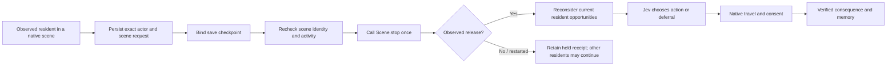

# Agent priority over native scenes

The observer now offers **Agent priority over native scenes** when starting the society. An individual resident's Needs panel also has **Release scene for agent control**. These controls can interrupt a Skyrim scene instead of indefinitely excluding its participants from agent activity. They operate on observed scene IDs, not a list of named NPCs or quests.

Stopping a scene can run its scripts and affect participants beyond the selected resident, including unloaded participants we cannot enumerate. This experimental mode changes the isolated simulation's story behaviour. It does not disable all quests, complete quest stages, or claim compatibility with every Skyrim quest. The original Steam installation is untouched.

## Execution and persistence

The service persists the request before dispatch. The native bridge checks that the resident is loaded, adult, alive, awake and outside combat, and that the same scene still owns them. It calls `Scene.stop()` once and waits for the actor's scene ID to remain zero for at least 250 ms. A different or restarted scene, unavailable API, or 15-second timeout produces a held receipt. The service independently checks the acknowledgement identity and the current actor observation before recording release.

The scene's owning quest ID is recorded; our code does not call `Quest.stop()`. Scene scripts may still change quest state. [Skyrim Platform's generated Scene interface](https://github.com/skyrim-multiplayer/skymp/blob/main/skyrim-platform/src/platform_se/codegen/convert-files/skyrimPlatform.ts) exposes the stop and owning-quest methods. Installed runtime availability is checked separately.

The director considers all currently observed initialized residents and requests at most one handoff per resident-event budget slot. It never automatically repeats a previously attempted scene in the saved history. A manual new request remains possible. Combat, sleeping, missing observations, navigation failures and active agent reservations still have physical meaning; this mode does not fabricate availability by deleting those checks.

A save/session change while a handoff is pending holds it instead of replaying the stop. Older saves discard future handoff records. The first subsequent resident plan retains its handoff ID, and the handoff records the resumed plan ID. Release itself changes no inventory, needs, relationship score or claimed memory of a conversation.

## Measurement

The observer exposes requested, pending, verified and held handoffs, native release latency, started plans and subsequent plan outcomes. A released scene is not a completed meal, sale or journey. Quest compatibility and long-term scene restart behaviour remain unmeasured.

## Live qualification

The isolated lab released Heimskr (108162) from scene 237915, owning quest 237914. Native telemetry recorded one stop call and a verified release after 261 ms; his package changed from the scene package to another native package. His existing pending need review then selected travel to a currently registered seller through Jev and acquired the agent package.

He walked to Carlotta, offered 3 gold for a loaf, heard her refusal, raised his offer to 5, and heard a second refusal. Four utterances completed. The plan finished as `seller_declined` with verified attendance release. No trade was recorded and all 29 compared inventories were unchanged. The plan and handoff retain each other's IDs.

Four Jev calls reported **US$0.000711228** in response usage, not an account billing audit. The utterances use deterministic text for the selected economic actions and current terms, voiced with Kokoro; there were no free-form language-model calls in this trial. Reply dispatch gaps were **10.032, 11.156 and 9.706 seconds**. This pipeline still has substantial latency despite subsecond decision calls.

Save `WS-SceneHandoff-20261025-AZ`, checkpoint **1323**, restored all **17** compared fields, including the new handoff history. [Compact native receipts, decisions, transcripts and save comparisons](evidence/scene-handoff.json) · [Listen to the four negotiation utterances](https://45ck.github.io/whiterun-society/#voice-example)

Controlled tests cover changed scenes, missing sensing, combat, restart/timeout, single stop dispatch, save/session changes, false acknowledgements, source-linked plans, and director ordering through checkpoint settlement. Hosted test results are available on the repository's current commit; passing tests does not establish broad quest compatibility.

This is native telemetry, not a new gameplay screenshot or video. The test does not prove every quest scene can be interrupted or that every released NPC will choose to leave.
