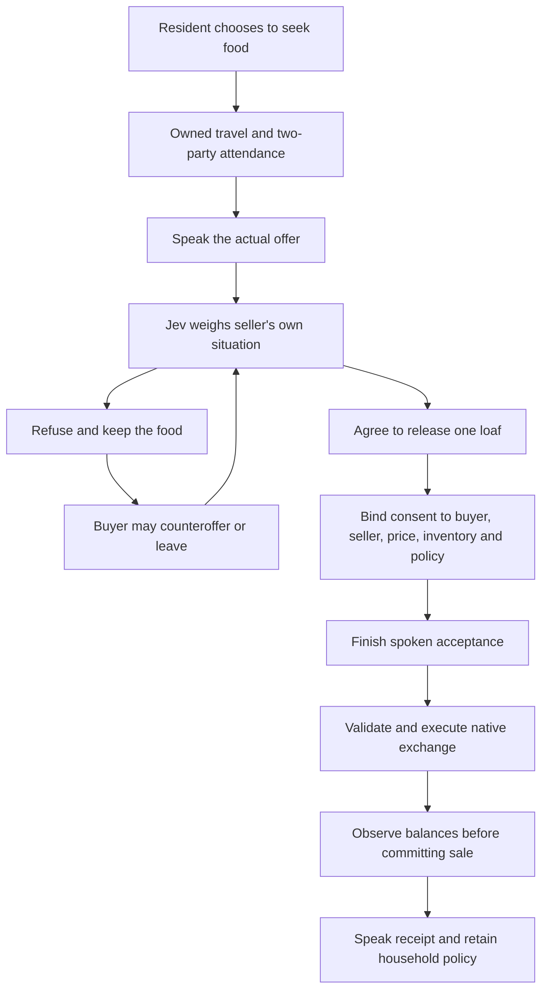

# Household food, spoken offers and observable outcomes

A resident's food allocation is now a revisable intention. Previously, `household_all` removed the sale choice entirely. A stock review could change that allocation, but urgent need reviews could indefinitely postpone the review. This helped explain a merchant standing with bread while hungry buyers repeatedly left empty-handed.

At an actual offer, a seller can now choose to release **one reserved loaf** or decline. Jev sees the seller's own needs, inventory, priorities and memories. The buyer does not receive the seller's private allocation or motive. The standing reserve policy remains in place for remaining stock.

The diagram describes available branches, not a claim that all were observed in the live trial. The native trial below exercised refusal; successful reserve release is currently supported by automated tests only.

## Live trial: a real choice to refuse

The operator selected the closest feasible pending food review, not a named pair or desired outcome. It selected Bergritte Battle-Born, 125.5 game units from the seller. Four actual Jev calls chose to seek bread, refuse, raise the offer and refuse again. Both seller decisions offered `decline` and `sell_reserved_bread`.

| Speaker | Spoken line |
| --- | --- |
| Bergritte | Would you sell me one loaf for 3 gold? |
| Carlotta | No, I will not sell a loaf on those terms. |
| Bergritte | Would 5 gold change your mind? That is my final offer for one loaf. |
| Carlotta | No, I will not sell a loaf on those terms. |

All four utterances completed unmuted with both participants nearby. The last line ended 40.062 seconds after worker start. The four decision receipts reported **$0.000773136** in aggregate usage cost; this is not a whole-session bill. The words and the 3/5-gold quotes are deterministic authored terms, not generated natural negotiation or market-discovered prices. Initial body turning briefly reached 174 degrees of error; successful attendance alone does not establish natural facing or eye contact.

Bergritte retained 35 gold and no bread. Carlotta retained 102 gold, five loaves and 20 grain. Neither refusal transferred anything or reduced the buyer's hunger. The seller's reserve policy stayed unchanged. Save `WS-Reserve-20261025-BE`, checkpoint 1659, restored all 17 compared fields. The actors' temporary task released; standing resident control remained enabled.

[Native evidence and exact decisions](evidence/reserve-reconsideration.json) · [Synthesized audio examples](https://45ck.github.io/whiterun-society/#voice-example)

## Make the difference visible

The shared in-game and browser charts now separate completed sales, seller refusals, buyers leaving, active negotiations, technical failures and unclassified outcomes. The denominator is retained voiced trade plans, including qualification experiments. A sale requires a committed native inventory receipt. A held plan with an already committed sale remains a sale here; the separate plan-failure metric still exposes its later failure.

Reserved-loaf sales have their own committed count. Acceptance, pending commands and failed transfers do not increment it. These are operational measures, not a score for economic realism.

## Voice routing

At Calvin's request, NPC audio is now explicitly selected to **Speakers (Realtek(R) Audio)**. Windows' default output is unchanged. A separate saved 2.74-second voice check completed; Realtek endpoint peak was 0.431 and game voice-process peak 0.240, while the Yeti endpoint remained zero. This is software signal evidence, not confirmation of physical speaker audibility or a new resident interaction. Realtek selection persisted through save restoration.

The authenticated local output-selection command matches one currently permitted device label. Missing or ambiguous matches fail without changing the prior selection. It requests no microphone access. Automatic refresh no longer duplicates options if startup discovery overlaps a selection request. The output picker can still be changed in the game; choose Windows default there to follow future OS changes.

## Remaining work and validation

The six reserve-consent tests cover one-off acceptance, refusal, voice-before-transfer, changed allocation, mismatched terms, old-save rollback and failed native transfers. The full local Python run passed 313 tests; the subsequently added metric case and amended service test pass separately. All 142 JavaScript tests pass. Hosted qualification is recorded in the build journal after publication.

This does not yet solve sustained production, employer consent, wages, business stock ownership, supply chains, endogenous prices or persistent meaningful daily routines. The live reserve-release sale remains unqualified. Native mouse/visual acceptance and a listening review are also outstanding. The full RTS economy and society goal remains active.
