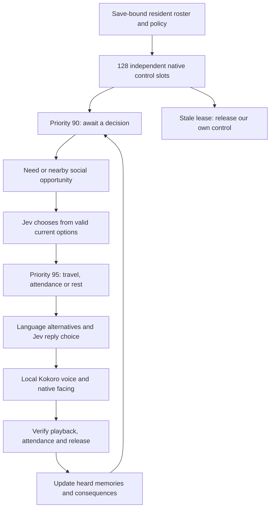

# Resident control between interactions

The RTS society now has an additive standing-control layer beneath temporary travel, rest and conversation tasks. Its first activity is **awaiting a decision**. This prevents enrolled, loaded residents from automatically returning to vanilla schedules when an interaction finishes. Standby is not work, rest, patrol, production or a model-authored daily routine.

The dashboard separates **Agent task**, **Agent standby**, **Native scene**, **Other native routine**, **Unknown** and **Not loaded**. Counts require the current engine package to match the claimed package. Resource cards report inventory-account coverage, need bars show their measured population, and economy totals retain their cumulative scope. The resident inspector distinguishes speaking, listening, travel, standby and control failures.

## Native qualification on 25 October 2026

- All **29 initialized residents** received stable slots. The first stationary sample held **9 loaded residents**, with one native-scene participant reported separately. After the camera loaded more residents and save restoration completed, **23** had observed standby ownership. This is not control of every Skyrim NPC or unloaded actor.
- Two independently selected guard pairs completed **8 generated lines** across two encounters: **54.935** and **56.680 seconds**. Native attendance acquired both participants, speech completed unmuted, and the temporary conversation packages released. The participants returned to their standing society packages.
- Body orientation was measured during speech. The first line included a roughly **177-degree initial error** while actors turned; later samples approached alignment. A successful look-at request does not prove eye gaze or raycast accuracy.
- During the second encounter, the Yeti output peaked at **0.493**, and the game voice process at **0.244**. Realtek remained **0**. This establishes a software audio signal on the Yeti headphone output, not physical audibility. Select the intended output in the voice panel if speakers are silent.
- Save **WS-Continuity-20261025-BC**, checkpoint **1553**, restored all **17 compared fields**, including the enabled policy and assignments. Native ownership was reacquired after restoration.

[Compact native evidence and utterances](evidence/resident-continuity.json) · [Hear the second encounter](https://45ck.github.io/whiterun-society/#voice-example)

The first candidate launch timed out at 180 seconds. The previous plugin set then loaded and restored in 124.7 seconds. After giving the new records unique editor IDs, the current candidate loaded and restored in 38.9 seconds. The startup cause remains unresolved; these trials do not establish that duplicate editor IDs caused it.

## Dialogue quality remains unfinished

The first pair invented patrol and market activity. Dialogue now receives the speaker's own observed activity, and the prompt distinguishes a profession from a current duty. The second pair avoided those patrol claims but produced repetitive questions and an awkward apology. That is a visible remaining failure, not proof of human-like interaction. Neither encounter completed a sale. Standing control and successful playback alone do not establish a working economy.

Next requirements are meaningful persistent destinations and duties, conversations grounded in actual actions and shared context, richer trade/production, varied voices, lip sync, and native RTS mouse/visual acceptance. Authored needs and personality values remain gameplay models, not validated measurements of human psychology.

## Implementation and recovery

`WhiterunCitizens.esp` adds its own records and `WSSocietyResident.pex`. It changes no vanilla records or existing society plugin records. Resident assignments are saved inside the town checkpoint. Census expansion allocates free slots without changing existing assignments; departed residents release their slots. Capacity overflow rejects enrollment rather than silently dropping residents.

The native lease uses a ten-second heartbeat watchdog, backed by a JavaScript stale-service release. The controller stops only its own plugin quests. Native scenes, combat, sleep transitions, unloaded actors and failed acquisitions remain explicitly reported. Short interactions use higher priority and do not need to destroy the standing assignment.

Build into a staging directory, install only while the isolated lab is stopped, and enable `--experimental-resident-control` in the launcher. Preserve existing lab flags and load order. Existing managed saves require the explicit additive migration `--allow-added-plugin WhiterunCitizens.esp`. The authenticated `POST /town/resident-control` accepts an event `id` and boolean `enabled` only when the town is synchronized and its director is idle. Never enable it while a launcher is still restoring a save: restoration intentionally restores the older policy too.

The full local run passed 305 Python and 139 JavaScript tests; the subsequently added chart and activity-context tests also pass. CI includes the expanded suite, all plugin builds, and both original Papyrus scripts. Native stale-service expiry, complete quest compatibility and a human listening review remain separate qualification work.
