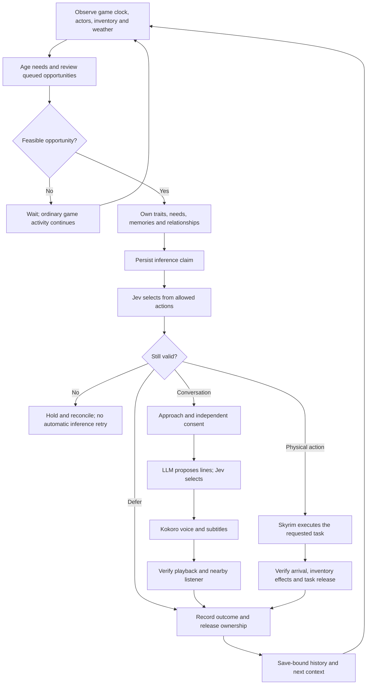
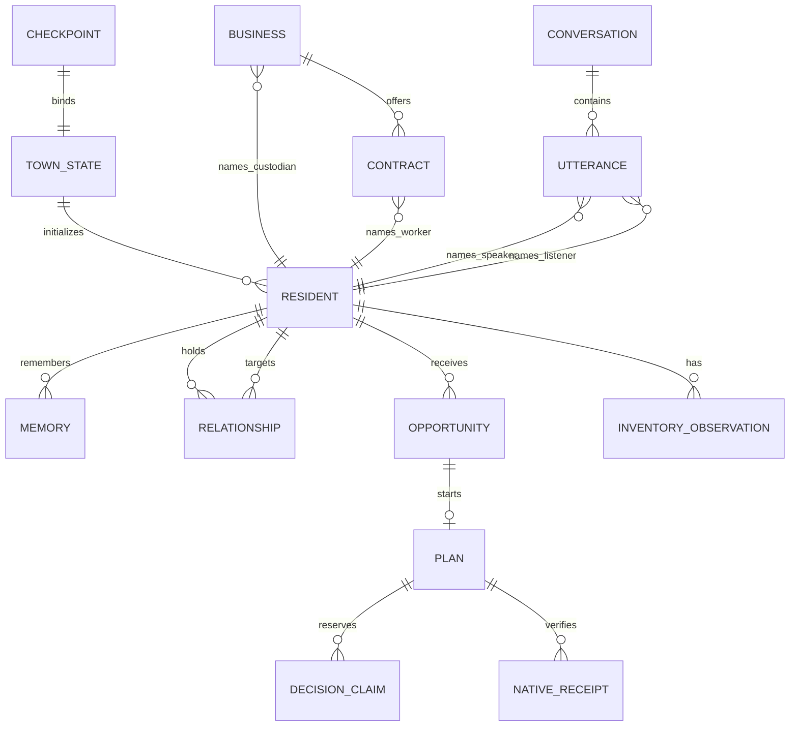

# The living society system

## Active goal

Build and demonstrate a Sims-like society inside Skyrim: residents pursue needs and personal goals, work and trade with finite resources, remember experiences, form relationships, and speak to each other. An observer can select, follow and inspect them, seeing the difference between an intention and its verified consequence. Keep the project open source and explain each major milestone with generated infographics, actual game screenshots and reproducible evidence.

This remains an active development goal. The current foundation covers 29 initialized adults, a small action vocabulary and one executable production recipe. It is not yet a sustainable town economy or a complete model of human behaviour.

*Generated architecture illustration. The status labels distinguish the working foundation from future expansion; the town artwork is not a game capture.*

## Who does what

| Layer | Responsibility today | Authority boundary |
| --- | --- | --- |
| Deterministic simulation | Age needs, queue opportunities, build feasible options, check resources, reserve inference claims, settle receipts and bind checkpoints | Owns economic rules and recorded consequences; cannot count an intention as completion |
| Jev decision model | Choose an allowed action, social partner, consent, utterance or private appraisal from the supplied alternatives | Cannot invent an executable action or override resource checks |
| Language model | Propose two context-sensitive dialogue alternatives from the speaker's own state and heard context | Currently a dialogue contributor, not a general autonomous planning agent |
| Local Kokoro | Synthesize the selected line using a stock voice | A generated WAV is not evidence that the listener heard it |
| Skyrim and our bridge | Execute owned travel tasks, native movement and animation; observe positions, inventories, playback and release | Skyrim supplies navigation. We request goals and validate outcomes; models do not calculate every footstep |

Event-driven intelligence means decisions happen at meaningful opportunities. Walking, work attendance and quiet periods do not continuously invoke models. The current director runs bounded sessions; it is not an always-on autonomous service.

The language component can be a small non-reasoning model. [The initial model comparison](model-routing.md) records current prices, nine real dialogue-only requests and the grounding failures that prevented a blind default switch.

## One resident's loop

A hungry resident can eat carried bread, seek a seller, seek work, visit, rest or defer when the corresponding options are feasible. The ordinary needs stage exposes at most five options at once. A market visit with no seller is a remembered failed visit, not a purchase or hunger relief.

The code can prioritize urgent executable needs over an unstarted invitation. It preserves started commitments. A certified interruption before any action can let the director continue with other residents; uncertainty about native effects still stops settlement.

## Economy and society feedback

The demonstrated production contract consumes **one grain**, creates **two bread**, and transfers **two gold** from employer to worker after **30 qualified game minutes**. Buying transfers existing goods and money; eating destroys one loaf and reduces simulated hunger. Stock reserves can make a seller refuse a sale even when the buyer wants food. No dialogue line can manufacture goods or settle a payment.

These are real native inventory effects under authored rules. Baking currently uses qualified attendance, not an oven animation. Employer inventories are the relevant accounts; a complete firm balance sheet, input market and replenishing agricultural chain remain future work. The separate farm–bakery–household model in `town.py` is not yet connected to these native actors.

Relationships are directional: a resident can feel supported while the other stays neutral. Heard statements remain source-tagged claims. Traits, need rates and relationship increments are gameplay parameters rather than validated psychometric measurements. Longer social negotiations, rumours, family duties and political institutions need additional executable state transitions, not simply more generated text.

## Data model

This is a conceptual view of current records, not a SQL schema. Many society records are persisted inside checkpoint state.

| Record | Important contents and limits |
| --- | --- |
| Resident | Native ID, authored profile, five Big Five traits, five needs; three needs age in the current reviews |
| Memory | Source, observed event or heard claim, actor and checkpoint; 32 retained memories, latest eight in typical decision context |
| Relationship | Directed affinity, familiarity and private appraisals; feelings are not automatically mutual |
| Inventory observation | Native actor account, observed gold/bread/grain, session and matching checkpoint |
| Business and contract | Owner/custodian, capabilities, offer, consent, attendance and verified settlement; one executable recipe |
| Opportunity and plan | Due review, priority, actor, state, chosen action, task ownership and interruption status |
| Inference claim | Persisted before a provider request, bounded allowance and accepted result; uncertain requests are not blindly repeated |
| Conversation | Participants, approach, consent, chosen lines, audio delivery and listener evidence |
| Checkpoint | Plan, people, economic journals and town state matched to a Skyrim save |

Household records currently use single-adult placeholders. A household entry is not evidence of a simulated family economy.

## How many possibilities?

The current audit identifies **23 decision families across multiple stages**, including reserve policies and private appraisals. They are not 23 independent physical verbs available to every person: defer, eat, keep food, seek bread, check market, visit Adrianne, seek work, offer shift, take shift, decline work, sell bread, decline, raise offer, leave negotiation, reserve all/one/two, rest at a bench, approach someone, chat, and three appraisals.

With six eligible partners, an accepted two-turn conversation has a structural ceiling of **216 branch combinations**: 6 partners × 2 first lines × 2 replies × 3 first-person appraisals × 3 second-person appraisals. This excludes refusal and changing availability. It is not a count of unique meanings, reachable world states or demonstrated outcomes. Text generation has no useful finite possibility count.

The action space is still too narrow for the target society. Track growth through consequential action families, connected recipes, different valid outcomes, reachable locations and persistent consequences. Multiplying decorative parameters would not improve the simulation.

## What success will look like

These are proposed next acceptance targets, not measured results:

| Objective | Next measurable demonstration |
| --- | --- |
| A functioning local economy | At least three connected native production recipes, competing buyers and sellers, conserved payments, and an explicit source for every input over a full simulated day |
| Independent lives | Every initialized resident is either carrying out a valid chosen task, intentionally quiet, unavailable or explicitly held; no silent stalls hidden by busy dialogue |
| Consequential society | A remembered encounter changes a later eligible choice; include refusal, neutrality and disagreement as legitimate outcomes |
| Watchable communication | A longer multi-turn exchange with verified proximity, turn order, subtitles and audio delivery, followed by a visible persistent consequence |
| Understandable observation | Select and follow the relevant residents, show the reason for a decision, then show the verified change to goods, needs or relationships |
| Reliable continuity | Save and restore each demonstrated settled scenario, with exact inventory/history comparison; retain failed and interrupted cases |

Measure model latency and reported cost per settled event, simulation wait time separately, needs satisfied, production/consumption throughput, failed visits, inventory discrepancies and unexplained holds. High activity alone is not success: resting, refusing and silence can be rational outcomes.

[Latest runtime evidence](town-progress.md) · [Video demonstration plan](demo-videos.md) · [Image-generation prompts](infographic-prompts.md)

## Resident-selected prices

Initialized towns now let buyers choose affordable bids and sellers choose acceptance, refusal or a counteroffer. Personal completed trades inform candidate prices; private counterparty resources stay out of prompts. Prices remain a bounded authored search space, not an equilibrium solution. A real Jev trial delivered two bids and two refusals; a controlled native counteroffer sale verified inventory and consent, then restored all 17 save fields. [Architecture, audio, screenshot and limitations](bargaining.md).
