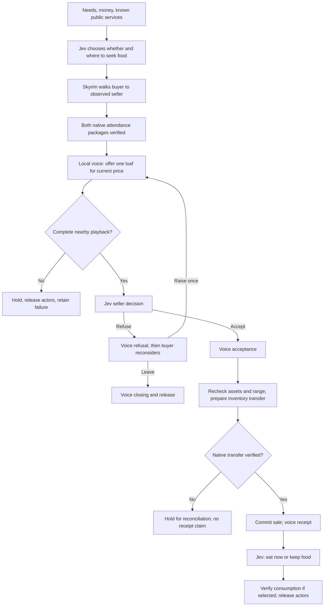

# A transaction you can hear

The society director enables voiced trade for economic events when voice-enabled social activity is configured. A resident still decides whether to seek food, approach a current public seller, accept/refuse a price, reconsider, eat or keep the purchase. This adds no continuous model loop and no extra cloud calls: the economic event retains its five-decision ceiling.

Economic utterances use deterministic wording of actual terms. The language model remains responsible for open social conversation; it is not allowed to invent prices, quantities or completed transfers in these transaction lines. This is an intentional grounding boundary, not a claim of natural negotiation dialogue. Personality affects the existing Jev decisions; these short lines currently have a neutral voice style.

## What is persisted

Each opted-in resident plan stores `voiced_trade`, a fixed `economic_pair`, verified attendance, the current economic speech act and a resume phase. The pending utterance contains its speaker, listener, exact line, origin session, audio hash, delivery ID and preparation timestamp. Only completed nearby playback becomes an `economic_turns` entry and a heard memory. The physical sale remains a separate committed trade with before/after inventory evidence. Replaying an event does not repeat model calls or purchases.

Up to five trade utterances cover an initial offer, refusal, higher offer, seller answer and either a confirmed receipt or departure. Speech uses the same stock Kokoro voices, captions, facing requests and playback protocol as social encounters. No lip-sync or gaze accuracy is claimed. The local voice child warms during travel and exits at the event boundary.

The observer shows the voiced terms and verified transfers separately. `delivered_trade_utterances` and `spoken_trade_acts` are delivery counts, not sales, human-quality scores or proof of autonomous markets. Economic history includes staged protocol experiments. A polite refusal is a valid outcome; missing/unloaded participants, incomplete audio and uncertain native effects are failures or holds.

## Verification boundaries

The live Amren–Carlotta encounter delivered four voiced terms: a 3-gold offer, refusal, a 5-gold counteroffer and refusal. Four Jev decisions selected those outcomes; both native attendance packages were released. Before/after inventories were identical. This proves the refusal path, not a successful sale. [Compact native receipt](evidence/voiced-trade-live.json)

Automated coverage exercises heard offer before seller choice; spoken consent before inventory mutation; verified transfer before receipt; a 3-to-5-gold counteroffer followed by refusal; incomplete playback; session changes without replay; and release of the old partner before a new destination. A caption regression test ensures a completed social scene cannot hide a currently speaking economic participant.

Real-world scarcity, market-clearing prices, multi-good negotiation, arbitrary contractual promises, spoken employment and rich sales dialogue remain unfinished. Public business registration does not expose private stock or guarantee willingness to sell. An unloaded shopkeeper cannot transact remotely under this protocol.
